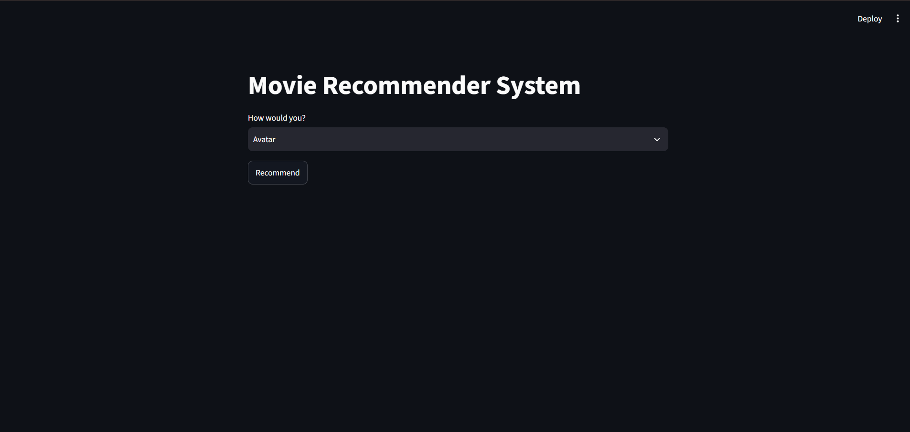
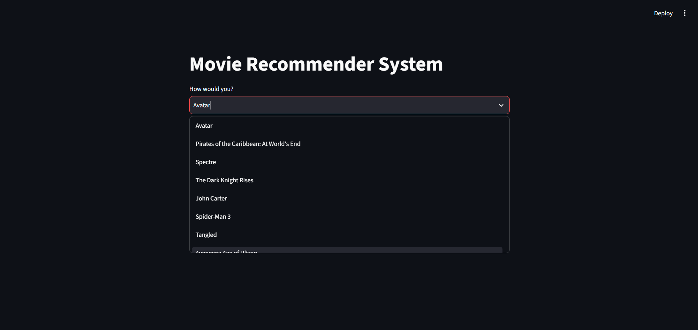
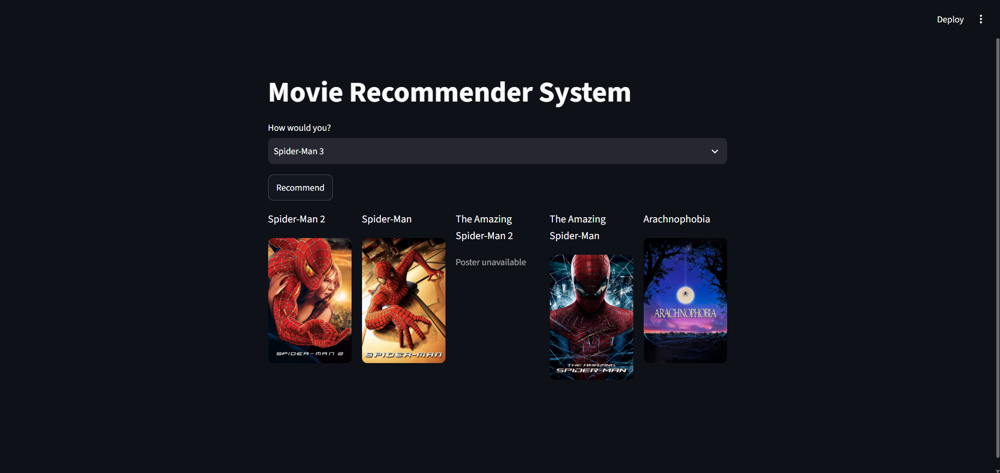

# 🎬 Movie Recommender System

A content-based Movie Recommender System built using Python, Machine Learning, and Streamlit. The application recommends five movies similar to a user's selected movie and retrieves movie posters using The Movie Database (TMDB) API.

## 📌 Project Overview

With thousands of movies available, finding movies that match a user's interests can be challenging. This project addresses that problem by analyzing movie metadata and calculating similarities between movies to generate relevant recommendations.

The project includes data preprocessing and model development in a Jupyter Notebook, followed by an interactive web application built with Streamlit.

## ✨ Features

- **Movie Recommendations:** Recommends five similar movies based on the selected movie.
- **Content-Based Filtering:** Uses movie metadata to calculate similarity between movies.
- **Interactive Interface:** Select a movie from a dropdown menu and view recommendations.
- **Dynamic Movie Posters:** Fetches movie posters using the TMDB API.
- **Error Handling:** Handles missing posters and API request failures.
- **Data Preprocessing:** Cleans and transforms movie metadata for recommendation generation.
## 📸 Screenshots

### Home Page


### Movie Selection


### Movie Recommendations



## 🛠️ Technologies Used

- Python
- Pandas
- NumPy
- Scikit-learn
- Jupyter Notebook
- Streamlit
- Requests
- python-dotenv
- TMDB API

## 📂 Project Structure

```text
Movie-Recommender-System/
│
├── Movie_Recommendor.ipynb
├── app.py
├── movies.pkl
├── movies_dict.pkl
├── similarity.pkl
├── tmdb_5000_movies.csv
├── tmdb_5000_credits.csv
├── Homepage.png
├── Movie_select.png
├── Recommended_Movies.png
├── requirements.txt
├── README.md
├── .env
└── .gitignore
```

**File descriptions**

| File | Description |
|---|---|
| `Movie_Recommendor.ipynb` | Data preprocessing, feature engineering, and recommendation model development |
| `app.py` | Streamlit application for displaying movie recommendations |
| `movies.pkl` | Serialized movie data used by the project |
| `movies_dict.pkl` | Serialized movie information loaded by the application |
| `similarity.pkl` | Precomputed movie similarity scores |
| `tmdb_5000_movies.csv` | Movie metadata dataset |
| `tmdb_5000_credits.csv` | Movie cast and crew dataset |
| `requirements.txt` | Python dependencies |
| `.gitignore` | Excludes private credentials and unnecessary files |

## ⚙️ How It Works

1. **Data Collection:** Loads movie metadata and credits from the TMDB 5000 datasets.
2. **Data Preprocessing:** Cleans the data and prepares relevant movie features.
3. **Feature Engineering:** Combines selected movie metadata into features suitable for comparison.
4. **Similarity Calculation:** Calculates similarity scores between movies using a content-based approach.
5. **Model Serialization:** Saves processed movie information and similarity scores into pickle files.
6. **Movie Selection:** The user selects a movie through the Streamlit interface.
7. **Recommendation Generation:** The application finds the selected movie's similarity scores and returns the five highest-ranked similar movies, excluding the selected movie itself.
8. **Poster Retrieval:** Fetches movie posters from the TMDB API and displays them alongside the recommendations.

## 🚀 Installation and Setup

### 1. Clone the repository

```bash
git clone https://github.com/aditya-gagare/Movie_Recomendation_System.git
cd Movie_Recomendation_System
```

### 2. Create a virtual environment (recommended)

```bash
python -m venv .venv
```

Activate it on Windows:

```powershell
.venv\Scripts\Activate.ps1
```

### 3. Install dependencies

```bash
python -m pip install -r requirements.txt
```

### 4. Configure the TMDB API

Create an account at [The Movie Database (TMDB)](https://www.themoviedb.org/) and obtain your API Read Access Token from your [API settings](https://www.themoviedb.org/settings/api).

Create a `.env` file in the project root:

```env
TMDB_API_TOKEN = your_actual_read_access_token
```

Replace the placeholder with your own token.

**Security:** Never commit your `.env` file or publish your API token. Ensure `.env` is included in `.gitignore`.

### 5. Run the application

```bash
python -m streamlit run app.py
```

Streamlit will provide a local URL, usually `http://localhost:8501`, where you can access the application in your browser.

## 📊 Dataset

This project uses the TMDB 5000 Movie Dataset, which contains movie metadata and credits information.

The data is used to prepare movie features and calculate similarities for content-based recommendations.

Dataset source: [TMDB 5000 Movie Dataset on Kaggle](https://www.kaggle.com/datasets/tmdb/tmdb-movie-metadata)

## 🔮 Future Improvements

- Add genre-based and user-preference filters.
- Improve recommendation quality using additional movie features.
- Add movie descriptions, ratings, genres, and release dates.
- Cache movie details and poster requests to improve performance.
- Deploy the application online so users can access it without running it locally.
- Add automated tests and recommendation evaluation metrics.

## ⚠️ Important Notes

- The `.pkl` files must be available in the expected project paths for the application to load.
- The TMDB API requires a valid credential to retrieve movie details.
- Some movies may not have a poster available through the API.
- Pickle files should only be loaded from trusted sources.

## 🙌 Acknowledgements

- [The Movie Database (TMDB)](https://www.themoviedb.org/) for movie metadata and poster images.
- [Kaggle](https://www.kaggle.com/) for hosting the dataset.
- The Python and Streamlit communities for their open-source tools.

---

**Developed as a Machine Learning project to explore content-based recommendation systems and interactive web application development.**
